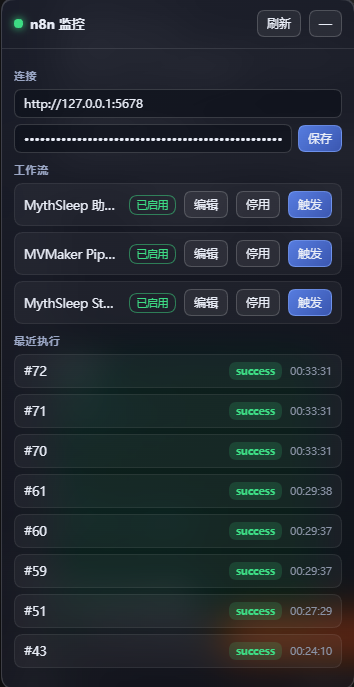
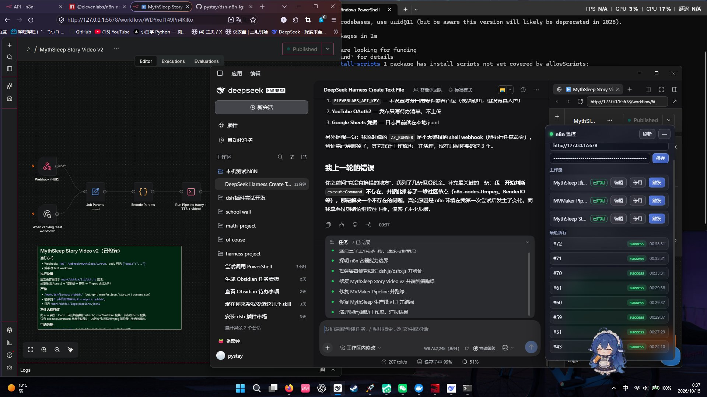

# dsh-n8n-lg

[](https://www.npmjs.com/package/dsh-n8n-lg)
[](./LICENSE)
[](https://nodejs.org)

> 一个给 **DeepSeek Harness (DSH)** 用的轻量 **n8n** 插件：
> 让 AI Agent 帮你**触发 / 监控 / 可视化搭建** n8n 工作流，并带一个**玻璃拟态浮窗**实时盯着 n8n。



---

## 👋 写在前面（作者的话）

我是一名**刚上大学的计算机专业大一新生**，这是我课余时间自己摸索着写的一个小插件。

因为还在学习阶段，**代码和设计上一定有很多不成熟、甚至写错的地方**。如果你在使用的过程中发现了
问题、或者觉得哪里可以做得更好，**非常欢迎指出来**——Issues 和 PR 我都会认真看、虚心学习。

这个项目的初衷很简单：我自己在用 DSH 和 n8n，觉得"每次都要切窗口、手动点"很麻烦，
就想试试能不能让 AI 帮我管起来。能力有限，做得不好的地方还请各位前辈多多包涵 🙏

---

## 它能做什么

- 🔧 **14 个工具**：把 n8n 公开 API 的能力交给 AI Agent（列表 / 创建 / 改 / 删 / 启停 / 触发 / 查执行 / 重试 / 停止）。
- 🪟 **玻璃 HUD 浮窗**：界面右下角一个小玻璃球，点开就是 n8n 监控面板——看工作流状态、点一下就能触发、看最近执行。
- 🧩 **可视化搭建**：你只要**说出需求**，AI 会在 n8n 里**一个一个节点地搭**，同时浮窗**自动打开内嵌 n8n 编辑器**并随每次保存刷新，你能**全程看着工作流长出来**——不用自己 import `.json`。
- 🐳 **可选容器沙箱**：用 Docker 把 n8n 跑在隔离容器里（仅绑 `127.0.0.1`）。

---

## 演示

### 1. 玻璃 HUD 浮窗（监控 + 一键触发）


### 2. 在 DSH 里内嵌 n8n 编辑器 —— AI 逐个节点搭建，你全程看着



---

## 安装

### 方式一：在 DSH 桌面端的「插件」里添加（推荐）

1. 打开 **DSH 桌面端** → 左侧 **「插件」**
2. 搜索或直接填入包名 **`dsh-n8n-lg`** → 安装
3. **重启 DSH 桌面端**（bundle 变更需要重启才会加载）

### 方式二：命令行

```sh
# 装到某个 profile（桌面端用的是 desktop profile）
dsh plugin --profile desktop add dsh-n8n-lg
```

> 装完记得**重启对应 profile / DSH 桌面端**。

---

## 配置

在 profile 的 `cordis.patch.yml` 里给插件行提供配置（或在浮窗里直接填）：

```yaml
- id: n8n-lg
  name: dsh-n8n-lg
  config:
    baseUrl: 'http://127.0.0.1:5678'
    apiKey: 'YOUR_N8N_API_KEY'
    allowedWebhookPaths: ['deploy/*']   # 可选：Webhook 白名单
    timeoutMs: 30000
```

| 字段 | 必填 | 默认 | 说明 |
|---|---|---|---|
| `baseUrl` | 否* | 沙箱端点 / `N8N_BASE_URL` | n8n 实例基址（*缺失时回退环境变量或沙箱端点） |
| `apiKey` | 否* | `N8N_API_KEY` | n8n 公开 API Key（**建议用环境变量，不要写进配置文件**） |
| `webhookAuthHeader` / `webhookAuthValue` | 否 | — | Webhook 节点开了 Header 认证时的头名/值 |
| `allowedWebhookPaths` | 否 | `[]` | Webhook 路径白名单；留空=放行全部，生产建议显式配置（支持 `*`） |
| `timeoutMs` | 否 | `30000` | 请求超时（毫秒） |
| `useTestWebhook` | 否 | `false` | 用 `/webhook-test/` 路径（调试用） |

> **关于密钥**：强烈建议把 API Key 放在环境变量 **`N8N_API_KEY`**（地址用 `N8N_BASE_URL`），
> 这样密钥完全不落配置文件、也不会被误提交到 Git。本项目**不会**把任何密钥写进仓库。

### 沙箱配置（可选，`sandbox.enabled: true`）

| 字段 | 默认 | 说明 |
|---|---|---|
| `sandbox.image` | `docker.n8n.io/n8nio/n8n:latest` | n8n 镜像 |
| `sandbox.containerName` | `dsh-n8n-lg` | 容器名 |
| `sandbox.hostPort` | `5679` | 宿主端口（仅绑 127.0.0.1，默认避开常见的 5678） |
| `sandbox.containerPort` | `5678` | 容器内端口 |
| `sandbox.dataVolume` | `dsh-n8n-lg-data` | 数据卷 |
| `sandbox.timezone` | `Asia/Shanghai` | 容器时区 |

---

## 在 DSH 里怎么用

插件是**工具（tool）**，**不需要把任何文档发给 DSH** —— 直接在对话里说需求，agent 会自动选用工具。

直接这样说就行：

- 「列出我的 n8n 工作流」
- 「查询 n8n 执行 `12345` 的状态」
- 「触发 webhook 路径是 `deploy` 的工作流，body 传 `{"env":"prod"}`」
- 「帮我做个工作流：收到 POST 请求后，把 body 里的 name 拼成问候语返回」

最后一句就是**可视化搭建**：AI 会建工作流 → 浮窗自动弹出编辑器（可内嵌就内嵌，
不可内嵌则给出外部打开入口）→ 一个个加节点 → 连线 → 激活。

---

## 提供的工具（21 个）

| 工具 | 对应 n8n 接口 |
|---|---|
| `n8n_list_workflows` | `GET /api/v1/workflows` |
| `n8n_get_workflow` | `GET /api/v1/workflows/{id}` |
| `n8n_create_workflow` | `POST /api/v1/workflows`（写前校验） |
| `n8n_update_workflow` | `PUT /api/v1/workflows/{id}`（自动补全必填字段，默认存草稿） |
| `n8n_delete_workflow` | `DELETE /api/v1/workflows/{id}` |
| `n8n_activate_workflow` | `POST /api/v1/workflows/{id}/publish`（回退 `/activate`） |
| `n8n_deactivate_workflow` | `POST /api/v1/workflows/{id}/deactivate` |
| `n8n_trigger_workflow` | 请求 `{n8n}/webhook/{path}`（支持 method / query / payload） |
| `n8n_get_execution_status` | `GET /api/v1/executions/{id}` |
| `n8n_list_executions` | `GET /api/v1/executions` |
| `n8n_retry_execution` | `POST /api/v1/executions/{id}/retry` |
| `n8n_stop_execution` | `POST /api/v1/executions/{id}/stop` |
| `n8n_add_nodes` | 增量加节点/连线（**幂等 + 校验 + 读回验证 + 自动快照**） |
| `n8n_open_editor` | 让玻璃浮窗**自动打开编辑器**（可内嵌则内嵌，否则给外部打开入口） |
| `n8n_validate_workflow` | 保存前体检：缺字段 / 重名 / 重复 Webhook 路径 / 悬空连线 / 不存在的节点类型 |
| `n8n_snapshot_workflow` | 记录内存快照（**回滚点**，每个工作流保留最近 5 份） |
| `n8n_restore_workflow` | 恢复到快照（**一步撤销**；恢复前会先给当前状态留快照） |
| `n8n_begin_build_session` | **开始搭建会话**：先声明计划（目标 + 步骤），用户在浮窗看时间线 |
| `n8n_get_build_session` | 查看会话状态、每步结果与整体进度 |
| `n8n_set_build_session_state` | **暂停 / 恢复 / 结束**会话（暂停期间写操作会被拦下） |
| `n8n_check_credentials` | **凭据向导**：激活前告诉你还缺哪些凭据、去哪里配 |

参数名、取值语义与响应体均与 n8n 公开 API 保持一致，响应**原样透传**（不做改名/裁剪）。

### 为什么写操作是安全的

所有写操作都经过内部的 `WorkflowEditor`：

- **幂等**：`n8n_add_nodes` 支持 `stepId`，同一步骤重试不会重复写入；节点按 id / name 去重。
- **串行**：同一工作流的写操作排队执行，避免并发读改写互相覆盖（丢更新）。
- **全通道合并**：连线按 `main` / `ai_languageModel` / `ai_tool` 等**所有通道**合并去重，不会覆盖既有连线。
- **写前校验**：缺 id/name/type、重名、重复 Webhook 路径、悬空连线都会被拦下，**有 error 就不写**。
- **写后验证**：写入后读回确认节点真的存在，结果里返回 `verified`。
- **可回滚**：每次写入前自动留一份快照，`n8n_restore_workflow` 可撤销。

### 容器沙箱工具（`sandbox.enabled: true` 时额外注册）

| 工具 | 作用 |
|---|---|
| `n8n_sandbox_start` | 启动（不存在则创建），返回 endpoint + `live`/`ready` |
| `n8n_sandbox_stop` | 停止容器 |
| `n8n_sandbox_status` | 状态（含 `managed`）+ 存活与**就绪**探测 |
| `n8n_sandbox_logs` | 读取容器日志（tail 上限 2000） |
| `n8n_sandbox_remove` | 删除容器（保留数据卷，不丢数据） |

启用后沙箱会注册为 Cordis 服务 `ctx.n8nSandbox`，其他插件可 `inject: ['n8nSandbox']` 复用。

> **安全边界**：这是**普通的持久化 Docker 隔离**，适合运行**受信任**的工作流，
> **不是**可安全执行任意恶意代码的强沙箱。可用 `sandbox.memoryLimitMb` / `cpus` /
> `pidsLimit` / `noNewPrivileges` 加固。容器带 `dsh-n8n-lg.managed=true` 标签，
> 同名但非本插件创建的容器会被**拒绝操作**。

---

## 玻璃 HUD 浮窗

- **位置**：界面右下角的玻璃球（`n8n`），点开是监控面板，点 `—` 收起。
- **连接配置**：填 n8n 地址（默认 `http://127.0.0.1:5678`）与 API Key，点「保存」。
  保存后配置交给宿主，**AI 工具与浮窗从此指向同一个实例**；面板上会显示当前连接来源。
- **工作流**：列出工作流 + 启用状态；可「编辑」「启用/停用」「触发」「快照」「回滚」「凭据」。
- **搭建进度（时间线）**：AI 开始搭建会话后，这里显示它的**计划**、每一步的真实结果
  （加了多少节点、读回验证是否通过、对应哪个快照、失败原因）与整体进度；
  你可以随时**暂停 / 恢复 / 终止**——暂停期间写操作会被宿主拦下。
- **凭据提示**：点「凭据」会列出该工作流还缺哪些凭据类型、涉及哪些节点、去哪里配置。
- **触发 body**：面板里有 JSON 输入框，触发时作为请求体发送（支持 GET 类 Webhook）。
- **编辑器**：点「编辑」→ 面板变宽并尝试内嵌 n8n 编辑器。浮窗会**先探测 n8n 是否允许被内嵌**：
  允许就内嵌并随保存自动刷新；**不允许就给出原因（例如 `X-Frame-Options: SAMEORIGIN`）与
  「在系统浏览器打开编辑器」按钮**，不会留一片空白。
  **要自己改就先关掉「自动刷新」**，避免刷新打断编辑。
- **最近执行**：最近 8 条执行 + 状态徽章；执行列表获取失败会单独提示，不会假装一切正常。
- **自动刷新**：每 5 秒轮询一次（连接状态、工作流、执行、AI 聚焦指令）。

> 实现说明：n8n 的 API **不返回 CORS 头**，浏览器不能直连，所以浮窗的请求走插件 node 半在 DSH
> webServer 上注册的**同源代理路由** `/api/dsh-n8n-lg/*`，由服务端再去访问 n8n。
> 浮窗需要宿主提供 `webServer`（Web / 桌面端 profile 都有）；纯 headless profile 下浮窗不会挂载，但工具照常可用。
> 浮窗**不携带**连接凭据，凭据只存在于宿主的连接管理器里，前端只拿到脱敏状态（仅 origin）。

---

## 搭建会话与进度时间线

让「AI 一步步搭」从「看不见的黑盒」变成**可观察、可控制**的过程：

1. Agent 先调 `n8n_begin_build_session` 声明**计划**（目标 + 有序步骤，每步一个 `stepId`）；
2. 每执行一步就调 `n8n_add_nodes` 并带上**相同的 `stepId`** → 结果自动落到时间线上；
3. 浮窗里能看到：计划、当前第几步、每步加了多少节点、读回验证是否通过、快照 id、失败原因；
4. 用户可以**暂停 / 恢复 / 终止**。

**暂停是真的生效的**：会话处于 `paused` 时，`n8n_add_nodes` / `n8n_update_workflow` /
激活操作都会被宿主拦下并返回 `{ ok:false, blocked:true, error }`，
而不只是界面上画个暂停图标。这样「停下来让我看看」才有意义。

会话只存在内存里（进程重启即清空），每个工作流保留最近 10 条。

## 凭据向导

激活失败最常见的原因就是缺凭据。`n8n_check_credentials`（或浮窗里的「凭据」按钮）会提前告诉你：

- **需要什么**：节点里已声明的凭据类型（权威）+ 内置的节点类型映射表（覆盖常见集成）；
- **已有什么**：`GET /api/v1/credentials` 返回的凭据类型集合（**只有类型，不含任何密钥**）；
- **差什么**：逐条列出凭据类型、涉及哪些节点、以及配置入口链接（`{n8n}/home/credentials`）。

> ⚠️ 这是**尽力而为**的静态分析：内置映射表不可能覆盖全部社区节点，也无法判断
> `httpRequest` 这类「可选鉴权」的节点；最终判定以 n8n 自己的激活校验为准。
> 另外：**本功能不会读取、也不会要求你把任何密钥贴进对话**——密钥请只在 n8n 界面里填写。

---

## 可视化搭建工作流

详细操作契约（含踩坑清单）见 [`docs/可视化搭建工作流.md`](./docs/可视化搭建工作流.md)。

一句话：**说需求 → AI 用 `n8n_create_workflow` 建空工作流 → `n8n_open_editor` 弹出编辑器 →
反复 `n8n_add_nodes` 一次加一步（带 `stepId`）→ `n8n_validate_workflow` 体检 →
`n8n_activate_workflow` 激活 → 点「触发」试跑**。出错就用 `n8n_restore_workflow` 回滚。

---

## ⚠️ 注意事项

1. **必须重启才生效**：bundle 有变更时，需要重启对应 profile / DSH 桌面端。
2. **触发走 Webhook**：n8n 公开 API 没有触发端点，所以触发是请求工作流自己的 Webhook。
   工作流里得有 **Webhook 节点**，并且**已激活**——否则会收到 404。
3. **200 通常只表示「已接收」**：除非 Webhook 的响应模式是「最后一个节点」，否则拿不到执行结果。
   想看结果请用 `n8n_get_execution_status`。
4. **激活后等几秒再触发**：n8n 注册 webhook 是**异步**的，激活后立刻触发可能 404，等 3–5 秒即可。
5. **`Manual Trigger` 不能激活工作流**：n8n 要求至少一个 Webhook / Schedule 之类的真触发器。
6. **同一工作流里 Webhook 路径不能重复**：否则 `publish` 报 `409 webhook path conflict`
   （`n8n_validate_workflow` 可以提前查出来）。
7. **`publish` 会校验节点配置与凭据**：缺参数或缺凭据都会 400（例如 Google Sheets 的 OAuth 凭据）。
   「能保存」不等于「能激活」，更不等于「业务能跑通」。
8. **连线两端必须都是已存在的节点**：否则 n8n 会以
   `400 Workflow structure is invalid … unknown_connection_target` 拒绝保存。
   插件会在**写入前**拦下这种情况（`n8n_validate_workflow` 也能提前查），
   所以搭建时请「先加节点，再连线」。
9. **快照只在内存里**：`n8n_snapshot_workflow` 的快照进程重启即失效，也不能替代 n8n 自身的备份。
   搭建会话同理（只存内存）。
10. **暂停会话会拦下所有写入**：包括浮窗里点的「启用」。要恢复请用
    `n8n_set_build_session_state`（或浮窗的「恢复」按钮），否则会一直写不进去。
11. **凭据向导只是提示**：它不会、也无法替你创建凭据，更不会向你索要密钥。
12. **浮窗依赖 `webServer`**：纯 headless profile 下没有浮窗（工具仍可用）。
13. **沙箱需要 Docker**：`sandbox.enabled: true` 时 Docker 守护进程要在运行；
    容器不是强隔离，只适合受信任的工作流。
14. **`executeCommand` 节点在 n8n v2 默认被禁用**（安全考虑）。如果你的工作流要用它，
    需要给 n8n 设 `NODES_EXCLUDE=[]`——这会允许工作流在你机器上执行 shell 命令，请自行权衡。
15. **n8n 默认不允许被内嵌**：n8n 2.43.5 会给所有 HTML 路由返回
    `X-Frame-Options: SAMEORIGIN`，而浮窗跑在自定义协议（`dsh-app://app`）上、与 n8n 不同源，
    所以浏览器会拒绝渲染那个 iframe。浮窗现在会**先探测**并改为提示你在系统浏览器打开编辑器；
    工作流列表、搭建进度时间线、快照/回滚、触发**都不受影响**。
16. **实测环境**：Windows + DSH 桌面端 + n8n 2.43.5。其他平台/版本我还没条件验证，欢迎反馈。

---

## 安全

- API Key 只存在 DSH 配置或环境变量里，**不落源码、不入日志**；浮窗也不携带凭据。
- `allowedWebhookPaths` 白名单可以限制 Agent 只能触发指定工作流，
  且会拒绝点段/编码点段等会改变 URL 语义的路径。
- 沙箱容器**只绑定 `127.0.0.1`**，不对局域网暴露；容器带归属标签，不会误操作你的同名容器。
- 凭据向导**只读元数据**（凭据类型），不读取任何密钥，也不会要求你提供密钥。

---

## 开发

```sh
npm install
npm test          # 单元测试（vitest）
npm run build     # 编译 TS + 打包客户端 bundle 到 lib/
```

---

## License

[MIT](./LICENSE)

---

## 最后

如果你觉得这个小插件还有点用，欢迎点个 ⭐；如果哪里做得不好，**请一定告诉我**，我会认真改。

—— 一名还在学习路上的大一学生
